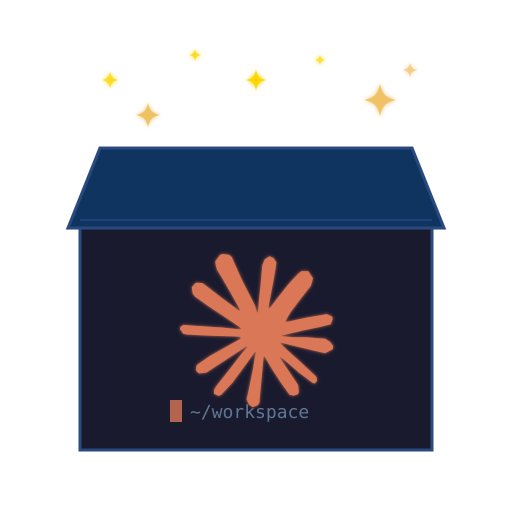
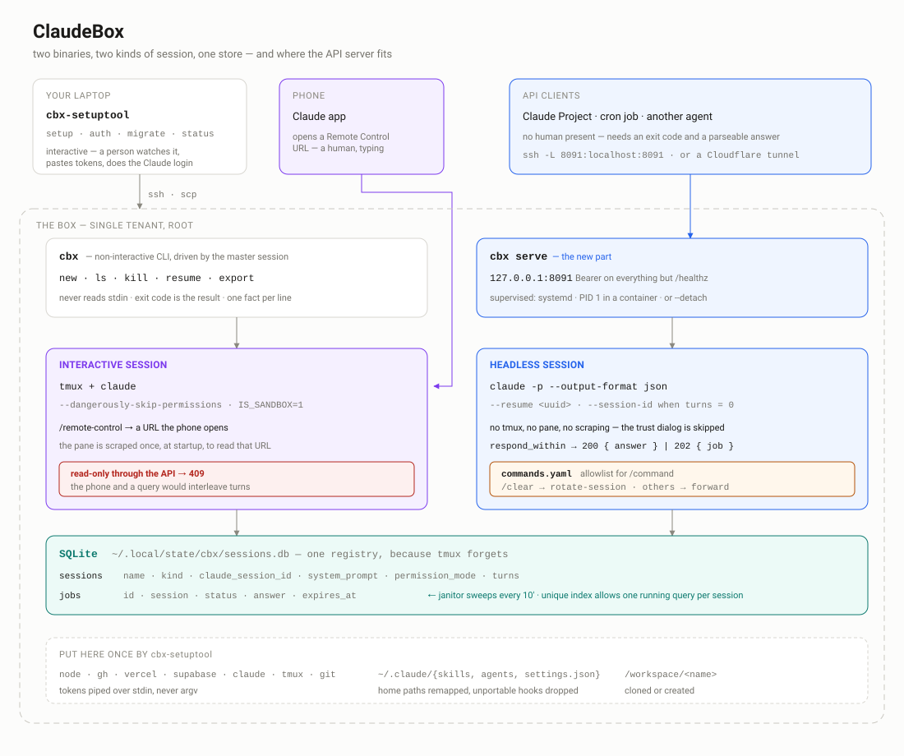

<p align="center">
  
</p>

# ClaudeBox

Claude Code on a machine you own: always on, open from the Claude app on your phone,
and callable over HTTP as the engine of your own AI service.

## The problems

1. **Prototyping an AI service means building an agent first.** Sessions, a tool loop,
   files the agent writes, a sandbox to run it in: all before you learn whether the
   idea works.
2. **Claude Code lives on your laptop.** Close the lid and it stops; run several at
   once and you are juggling terminals you cannot reach from your phone.
3. **Hosted agent sandboxes are someone else's machine.** Their tools, not yours, and
   wiped between runs: no Docker, no wrangler, no Vercel CLI unless they chose it.
4. **An agent that works with your services needs your secrets.** Put in a prompt or
   handed to a third-party sandbox, they leave your control.

## ClaudeBox

A Linux machine you own runs Claude Code, managed by `cbx` on the box and set up by
`cbx-setuptool` from your laptop.

<p align="center">
  
</p>

1. **The agent is already built; your service just calls it.** `cbx serve` puts
   Claude Code behind an HTTP API: give a session its rules, model and knowledge, ask
   it, and collect the answer and the files it wrote. A key's role bounds what its
   sessions may touch.
2. **Always on, many sessions, all in the Claude app.** A master session starts others
   on the box, and each opens in the official Claude app through Remote Control. Start
   from your phone, pick up from any device.
3. **Your environment, kept.** Node, the GitHub, Vercel and Supabase CLIs and uv are
   installed on request; anything else (Docker, wrangler, a database) you install as
   on any server, and every session can use all of it, run after run.
4. **Your secrets stay on your side.** Tool logins are made on the box from tokens
   piped over SSH. The values your service gives a session reach its tools as
   environment, never the prompt, and are shown by name only. Nothing runs in someone
   else's sandbox.

## Quick start

```bash
curl -fsSL -o cbx-setuptool \
  https://github.com/vutran1710/claudebox/releases/latest/download/cbx-setuptool-darwin-arm64
chmod +x cbx-setuptool
./cbx-setuptool setup --host <ip> --with-api   # any Ubuntu machine you can ssh into
ssh <ip> cbx new master                         # open the URL it prints on your phone
```

## Read next

- [docs/guide.md](docs/guide.md): set up a box, run sessions, drive the HTTP API
- [openapi.yaml](openapi.yaml): the API contract, also served by the box
- [docs/api-server.md](docs/api-server.md): how the API server works, and why
- [docs/two-binaries.md](docs/two-binaries.md): why a laptop tool and a box tool
- [docs/decision-log.md](docs/decision-log.md): choices made, and what would make each wrong
