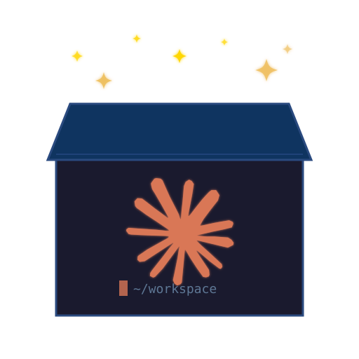
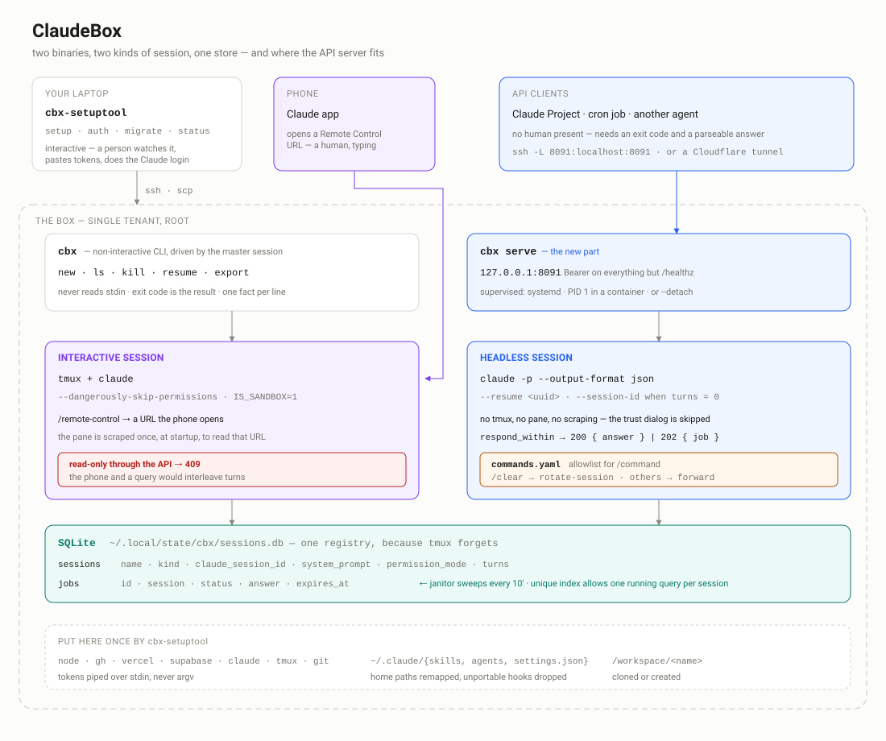
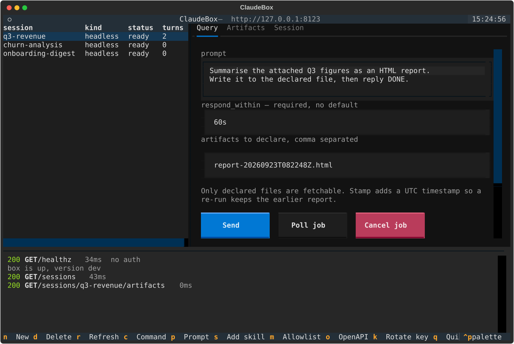

<p align="center">
  
</p>

# ClaudeBox

Your own Claude Code agent, always on, reachable from your phone.

A box in the cloud runs Claude Code sessions you can open from the Claude app —
no laptop required, nothing to keep awake.

<p align="center">
  
</p>

## Two commands

ClaudeBox is two binaries because it does two unrelated jobs.

**`cbx-setuptool`** runs on your laptop and prepares a machine. Interactive: it
shows progress, asks for tokens, and hands you the Claude sign-in.

**`cbx`** runs on the box and manages sessions. Non-interactive: it never
prompts, never reads stdin, and prints one tab-separated fact per line, because
its caller is the Claude session itself.

See [docs/two-binaries.md](docs/two-binaries.md) for why.

## Getting started

Create an Ubuntu machine with your SSH key on it — a DigitalOcean droplet, or
anything you can `ssh` into. Root is not required: name the user and the
privileged steps go through `sudo`, which is checked before the first one runs.
Then, from your laptop:

```bash
# grab cbx-setuptool for your laptop from the latest release
curl -fsSL -o cbx-setuptool \
  https://github.com/vutran1710/claudebox/releases/latest/download/cbx-setuptool-darwin-arm64
chmod +x cbx-setuptool

./cbx-setuptool setup --host <ip> --with-api

# a box that refuses root over ssh — Tailscale forbids it by default
./cbx-setuptool setup --host deploy@<ip> --with-api
```

That installs the base packages and Claude Code, downloads `cbx` onto the box,
signs Claude Code in, and authenticates `gh`/`vercel`/`supabase` from tokens.
Each step is skipped if already done, so re-running after a failure is cheap.

No Claude configuration is copied unless `--path` names a directory to copy.
There is deliberately no default: the obvious one, `~/.claude`, is personal,
and putting it on a machine other people share is not something to do by
omission.

The rest of the tool chain is opt-in. `--with` names what you want, and adding
one later is another `setup` run:

```bash
./cbx-setuptool setup --host <ip> --with node,"github cli"
```

`node`, `github cli`, `vercel cli`, `supabase cli` and `uv` are the choices.
`vercel` is an npm global, so asking for it without `node` is refused at the
flag rather than eight steps later at the `npm` call.

`uv` also installs a managed Python 3.12. Without one, uv uses whatever
interpreter the box has — a real box turned out to carry a hand-built 3.10 with
no `_ctypes`, which installs packages happily and fails at import.

`cbx` is fetched from a release matching this tool's own version — the two are
built from the same commit, so pairing them is what stops a setuptool
configuring a `cbx` that lacks the command it just wrote a unit for. Pin one
with `--cbx-version v0.10.0`, or upload a local build with `--binary ./cbx-linux`
when testing something unreleased:

```bash
GOOS=linux GOARCH=amd64 go build -o cbx-linux ./cmd/cbx
./cbx-setuptool setup --host <ip> --binary ./cbx-linux
```

Then start the always-on session and open its URL on your phone:

```bash
ssh root@<ip> cbx new master
```

## `cbx` — on the box

```
cbx new <name> [--repo owner/repo]   start a session, print its Remote Control URL
cbx ls                                every session, and whether it is running
cbx resume <name>                     a running session's URL and attach command
cbx kill <name>                       stop it and forget it
cbx export skills|rules|db            what this box has, to stdout
```

Sessions are recorded in SQLite, so a session that dies is reported `stopped`
rather than vanishing, and a Remote Control URL survives a tmux restart.

## `cbx-setuptool` — on your laptop

```
cbx-setuptool setup   --host <ip> [--with-api] [--with node,gh] [--path <dir>]
cbx-setuptool auth    --host <ip> [github|vercel|supabase]
cbx-setuptool migrate --host <ip> --path <dir> [--filter a,b]
cbx-setuptool status  --host <ip>    what is installed and authenticated
cbx-setuptool api     --host <ip> key add <label> --role <role>
```

`--host` takes `user@host` as well as a bare host, and `--user` says the same
thing separately. A bare host means root. Giving both, disagreeing, is an
error rather than a precedence rule nobody reads.

Tokens are piped over SSH into each tool's own login rather than passed as
arguments, where they would be visible in the box's process table. A token
already in your environment (`GH_TOKEN`, `VERCEL_TOKEN`,
`SUPABASE_ACCESS_TOKEN`) is used without asking.

`migrate` copies the parts of a Claude configuration directory that shape a
session — by default `skills`, `agents`, `rules`, `settings.json` and the
plugin manifest. `--path` says which directory, and is **required**: what
ships to a box is a decision, and the obvious default would be whoever ran the
command's personal configuration. `--filter` picks what inside it travels.

`settings.json` is rewritten on the way: paths under your home directory are
remapped, and hooks calling binaries the box does not have are dropped and
reported. Copied verbatim they would fail on every edit inside every session.

Each entry is reported with the number of files it actually sent, because a
directory of symlinks into a dotfiles repository once migrated as empty and
was reported as copied.

## What a session's tools are told

A session's tools (its MCP servers, the scripts they run) often need to know who
a run is for and which API to read. Written into the prompt, that is left to the
model; ClaudeBox passes it as environment instead, in three layers:

```yaml
# ~/.config/cbx/cbx.yaml
env:                         # the box's own, for every session
  API_URL: https://api.example.com
roles:
  reporter:
    session_env: [TENANT_ID] # names a session may set when it is created
    query_env: [USER_KEY]    # names a query may set for its own turn
```

```
POST /sessions          {"name": "t-1", "env": {"TENANT_ID": "12"}}
POST /sessions/t-1/query {"prompt": "...", "env": {"USER_KEY": "uk_..."}}
```

- A session's env is stored with it and set on every turn. A query's env is set
  on that turn only and never stored, which is where a credential that expires
  belongs.
- A name its role does not list is refused with `400`, so no caller can set
  `PATH` or `LD_PRELOAD`, and a query cannot change a name its session set.
- The box's `env` is read every turn, so changing it needs no new sessions; a
  session's or a query's value wins over it.
- Reading a session shows the names it was given, never the values.

Why it works this way: [docs/api-server.md](docs/api-server.md#env-a-sessions-tools-read).

## Testing

```bash
go test ./...              # unit and integration, drives real tmux and SQLite
scripts/smoke-api.sh       # drive the HTTP API against the Claude on this machine
scripts/smoke.sh --create  # provision a real droplet, drive it, destroy it
```

`cbx` has no remote dependency, so it is fully testable on a laptop. The smoke
test exists because fakes cannot model a shell, a PATH, an installer that exits
0 having done nothing, or Claude asking to trust a folder — every serious bug in
this project was found by running against a real box.

## Example client

A Python client and a terminal app for driving the API by hand live in
[clients/python](clients/python). Every request it makes is shown with its
status and duration, because the point is to make the API legible rather than
hide it.

```bash
uv run clients/python/tui.py --key "$(ssh <ip> cbx api-key list | cut -f2)"
```

<p align="center">
  
</p>

`clients/python/claudebox.py` has no terminal-UI imports and one dependency —
lift it into a service as it is.

## Docs

- [docs/two-binaries.md](docs/two-binaries.md) — why the split
- [docs/api-server.md](docs/api-server.md) — the API server, and why it is not `cbx serve` returning
- [docs/decision-log.md](docs/decision-log.md) — choices made, why, and what would make each wrong
