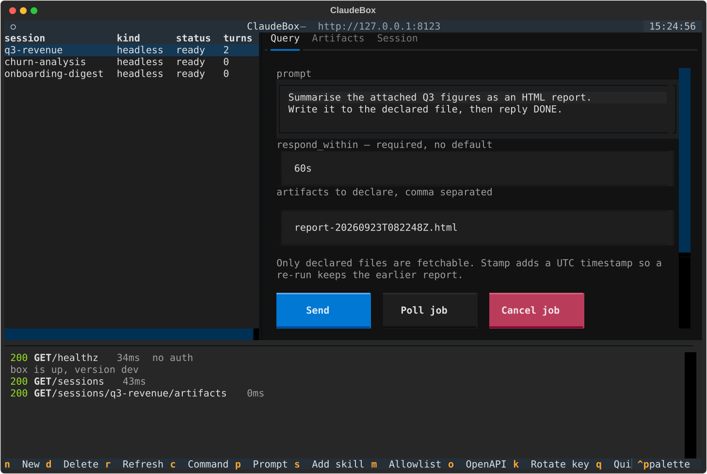

# Using ClaudeBox

How to set up a box, run sessions on it from your phone, and drive it over HTTP. What
it is for: the [README](../README.md).

## Two binaries

**`cbx-setuptool`** runs on your laptop and prepares a machine. Interactive: it
shows progress, asks for tokens, and hands you the Claude sign-in.

**`cbx`** runs on the box and manages sessions. Non-interactive: it never prompts,
never reads stdin, and prints one tab-separated fact per line, because its caller
is the Claude session itself. Why the split: [docs/two-binaries.md](two-binaries.md).

## Set up a box

Create an Ubuntu machine with your SSH key on it: a DigitalOcean droplet (the
**Deploy to DigitalOcean** workflow makes one), or anything you can `ssh` into.
Root is not required: name the user and the privileged steps go through `sudo`.
Then, from your laptop:

```bash
# cbx-setuptool for your laptop, from the latest release
curl -fsSL -o cbx-setuptool \
  https://github.com/vutran1710/claudebox/releases/latest/download/cbx-setuptool-darwin-arm64
chmod +x cbx-setuptool

./cbx-setuptool setup --host <ip> --with-api             # --with-api runs cbx serve as a service
./cbx-setuptool setup --host deploy@<ip> --with-api      # a box that refuses root over ssh
ssh <ip> cbx new master                                   # the always-on session; open its URL on your phone
```

`setup` installs the base packages and Claude Code, the `cbx` built from the same
commit as the setuptool, signs Claude Code in, and authenticates `gh`, `vercel` and
`supabase` from tokens. Each step is skipped when already done, so re-running after
a failure is cheap.

- **More tools:** `--with node,"github cli","vercel cli","supabase cli",uv`, now or
  in a later run. `vercel` needs `node`, and asking for it alone is refused at the
  flag. `uv` brings a managed Python 3.12.
- **Your Claude configuration:** nothing is copied unless `--path` names a
  directory; the obvious default, `~/.claude`, is personal.
- **A pinned or local `cbx`:** `--cbx-version v0.10.0`, or `--binary ./cbx-linux`
  for an unreleased build (`GOOS=linux GOARCH=amd64 go build -o cbx-linux ./cmd/cbx`).

## On your phone: sessions

```
cbx new <name> [--repo owner/repo]   start a session, print its Remote Control URL
cbx ls                                every session, and whether it is running
cbx resume <name>                     a running session's URL and attach command
cbx kill <name>                       stop it and forget it
cbx export skills|rules|db            what this box has, to stdout
```

The master session runs these itself: ask it for a session on a repository and it
answers with the URL. Sessions are recorded in SQLite, so one that dies is reported
`stopped` rather than vanishing, and a Remote Control URL survives a tmux restart.

## Over HTTP: an AI service's backend

`cbx serve` answers on the box; every endpoint but `/healthz` needs a key
(`cbx api-key add <label> --role <role>`). The full contract is `openapi.yaml`,
served at `/openapi.yaml`.

| | |
|---|---|
| `POST /sessions` | A headless session: its system prompt, model, effort, knowledge files, env, skills |
| `POST /sessions/{name}/query` | Ask it; the answer comes back at once or as a job to poll |
| `GET /jobs/{id}` · `DELETE /jobs/{id}` | A query's outcome; cancel one still running |
| `GET /sessions/{name}/artifacts/{path}` | A file the query declared it would write |
| `POST /sessions/{name}/command` | A slash command from the box's allowlist (`/compact`, `/model`…) |
| `GET` · `PUT /commands` | That allowlist |
| `GET` · `PUT` · `DELETE /envs/{name}` | The box's env map, below |
| `POST /auth/rotate` | Replace your own key |

**A key's role is the boundary.** It names the files its sessions are refused
(`deny` rules handed to Claude Code; by default the box's own guide, skills and
config) and the environment a caller may set. The caller never picks its role.

### What a session's tools are told

A session's tools (its MCP servers, the scripts they run) often need to know who a
run is for and which API to read. Written into the prompt, that is left to the
model; ClaudeBox passes it as environment instead:

```yaml
# ~/.config/cbx/cbx.yaml
env:                                  # the box's own, for every session
  API_URL: https://api.example.com
roles:
  reporter:
    session_env: [TENANT_ID, API_URL] # names a session, or an entry it takes, may set
    query_env: [USER_KEY]             # names a query may set for its own turn
```

```yaml
# ~/.config/cbx/envars.yaml: the env map, written through the API, one entry per place
prod:
  API_URL: https://api.example.com
preview.1234:
  API_URL: https://api-1234.example.com
```

```
PUT    /envs/preview.1234  {"API_URL": "https://api-1234.example.com"}
POST   /sessions           {"name": "t-1", "env_from": "preview.1234", "env": {"TENANT_ID": "12"}}
POST   /sessions/t-1/query {"prompt": "...", "env": {"USER_KEY": "uk_..."}}
DELETE /envs/preview.1234
```

- A session's env is fixed when it is created and set on every turn; a query's is
  set on that turn only and never stored, which is where an expiring credential
  belongs.
- A name its role does not list is refused with `400`, so no caller can set `PATH`
  or `LD_PRELOAD`, and a query cannot change a name its session set.
- The box's `env` is read every turn; a session's or a query's value wins over it.
- The env map serves a caller reached from several places, one entry per
  deployment say: `env_from` copies an entry into the session at creation, held to
  the role's `session_env`. The session takes the union of the entry and its own
  `env`, its own value winning on a name in both.
- Reading a session or the map shows names, never values.

Why it works this way: [docs/api-server.md](api-server.md#env-a-sessions-tools-read).

## Testing

```bash
go test ./...              # unit and integration, drives real tmux and SQLite
scripts/smoke-api.sh       # drive the HTTP API against the Claude on this machine
scripts/smoke.sh --create  # provision a real droplet, drive it, destroy it
```

`cbx` has no remote dependency, so it is fully testable on a laptop. The smoke test
exists because fakes cannot model a shell, a PATH, an installer that exits 0 having
done nothing, or Claude asking to trust a folder: every serious bug in this project
was found by running against a real box.

## Example client

A Python client and a terminal app for driving the API by hand live in
[clients/python](../clients/python). Every request is shown with its status and
duration, because the point is to make the API legible rather than hide it.

```bash
uv run clients/python/tui.py --key "$(ssh <ip> cbx api-key list | cut -f2)"
```

<p align="center">
  
</p>

`clients/python/claudebox.py` has no terminal-UI imports and one dependency: lift
it into a service as it is.
